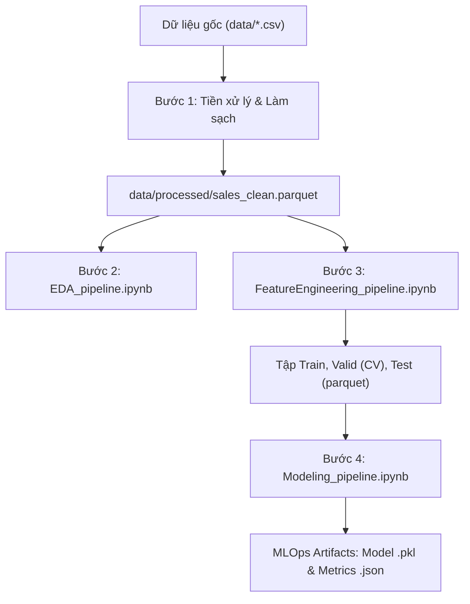

# Thiết Kế Và Triển Khai Quy Trình MLOps Cho Hệ Thống Dự Báo Nhu Cầu Sản Phẩm
*(Design and Implementation of an MLOps Pipeline for a Product Demand Forecasting System)*

Đồ án chuyên ngành ngành Kỹ thuật phần mềm / Khoa học dữ liệu.

---

## 📖 1. Giới thiệu bài toán

Hệ thống tập trung giải quyết bài toán **Dự báo nhu cầu chuỗi cung ứng bán lẻ (Retail Demand Forecasting)** trên tập dữ liệu chuẩn **M5 Forecasting (Walmart)** từ Kaggle:
- **Mục tiêu:** Dự báo chính xác số lượng bán ra của từng sản phẩm tại từng cửa hàng trong **28 ngày tiếp theo** (từ ngày $T+1$ đến $T+28$).
- **Thách thức kỹ thuật:**
  1. **Quy mô dữ liệu lớn:** Hơn 46 triệu dòng lịch sử giao dịch từ 2011 đến 2016.
  2. **Dữ liệu phân tán nhiều số 0 (Zero-Inflated / Intermittent Demand):** Hơn 55% ngày bán có doanh số bằng 0, phân phối lệch phải mạnh mẽ.
  3. **Nguy cơ rò rỉ thông tin tương lai (Data Leakage):** Dự báo trước 28 ngày đòi hỏi toàn bộ thông tin lịch sử phải được dịch chuyển tối thiểu 28 ngày (`shift >= 28`).
  4. **Nghẽn tài nguyên trên máy cá nhân:** Các file CSV gốc quá nặng, dễ gây tràn bộ nhớ (Out-Of-Memory) khi huấn luyện.

---

## 🏗️ 2. Kiến trúc tổng thể của Pipeline (MLOps Flow)

Quy trình MLOps được thiết kế tuần tự, tối ưu hóa qua từng giai đoạn và sử dụng định dạng **Parquet (Snappy)** giúp nén dung lượng, tăng tốc độ đọc ghi gấp hàng chục lần so với CSV truyền thống:



---

## 📂 3. Chi tiết các Notebook Pipeline vừa tạo

Bộ 3 Notebook được chuẩn hóa lại toàn diện từ các file nghiên cứu thô ban đầu (`EDA.ipynb`, `FeatureEnggineering.ipynb`, `Modeling.ipynb`):

### 📊 3.1. `EDA_pipeline.ipynb` – Khám Phá & Phân Tích Dữ Liệu
Tập trung làm sáng tỏ bản chất chuỗi thời gian bán lẻ để định hướng cho kỹ thuật tạo đặc trưng:
- **Xử lý Zero-Sales & Phân loại Syntetos-Boylan:** Chỉ ra 55.2% ngày có số bán bằng 0; 72% chuỗi thuộc nhóm *Intermittent* (nhu cầu gián đoạn) và 17.9% thuộc nhóm *Lumpy* (thất thường). Điều này quyết định việc lựa chọn hàm mất mát Tweedie thay cho MSE thông thường.
- **Tính chu kỳ theo tuần (Day-of-Week Effect):** Thứ Bảy và Chủ nhật có sức mua cao hơn ngày thường **41.7%**.
- **Chương trình tem phiếu thực phẩm (SNAP):** Ngày mở phát tem phiếu làm doanh số nhóm hàng `FOODS` tăng vọt **+12.3%** so với ngày thường.
- **Tác động của ngày lễ/sự kiện:** Các ngày SuperBowl, LaborDay kích cầu mạnh (+18% đến +28%), trong khi Giáng sinh (25/12) doanh số giảm về 0 do siêu thị đóng cửa.
- **Độ co giãn theo giá (Price Elasticity):** Khi sản phẩm giảm giá dưới mức trung bình của chính nó, sản lượng bán ra tăng gấp 1.2 – 1.4 lần.
- **Hệ số tự tương quan (Autocorrelation - ACF):** Đạt các đỉnh tại các bội số của 7 ngày (7, 14, 21, 28, 35,...), chứng minh chu kỳ tuần lặp lại rất đều đặn.

---

### ⚙️ 3.2. `FeatureEngineering_pipeline.ipynb` – Kỹ Thuật Tạo Đặc Trưng
Khắc phục hoàn toàn tình trạng chạy quá 45 phút và nghẽn RAM >12GB của file cũ bằng **Vectorization** và **Groupby trực tiếp**:
- **Nguyên tắc chống rò rỉ dữ liệu (Preventing Data Leakage):** Mọi đặc trưng chuỗi thời gian đều bắt buộc trễ ít nhất 28 ngày (`shift >= 28`) để đảm bảo mô hình không "nhìn thấy trước" doanh số của chu kỳ dự báo.
- **55 Cột Đặc Trưng Được Tạo Ra:**
  1. **Nhóm Lịch & Thời gian (Calendar):** `week_number`, `day_of_month`, `day_of_week`, `is_weekend`, `season`, `month_start`, `month_end`, `quarter_start`, `quarter_end`, `year_start`, `year_end`, `has_event`.
  2. **Nhóm Giá bán (Price - Điểm mới bổ sung):** `sell_price`, `price_max`, `price_mean`, `price_norm` (giá hiện tại / giá max), `price_rel_mean` (giá hiện tại / giá TB), `price_change_w` (% đổi giá sau 7 ngày), `price_nunique`.
  3. **Nhóm Trễ Lịch Sử (Lags):** Các độ trễ bội số của 7: `lag_28`, `lag_35`, `lag_42`, `lag_49`, `lag_56`, `lag_63`, `lag_70`.
  4. **Nhóm Thống Kê Trượt (Rolling Statistics):** Trung bình và độ lệch chuẩn trượt trên chuỗi dịch 28 ngày: `roll_mean_7`, `roll_std_7`, `roll_mean_14`, `roll_std_14`, `roll_mean_28`, `roll_std_28`, `roll_mean_56`, `roll_std_56`.
  5. **Đặc trưng độ đều đặn & EWM:** `nonzero_ratio_28` (tỷ lệ ngày có bán trong tháng), `ewm_sales_28` (trung bình hàm mũ `alpha=0.99`).
- **Phân chia tập dữ liệu theo thời gian (Time-Based Splitting):**
  - **Train Set:** 4.404.119 dòng (từ `2011-04-09` đến `2016-03-27`).
  - **Validation Set (CV):** 85.346 dòng (28 ngày từ `2016-03-28` đến `2016-04-24`).
  - **Test Set:** 85.372 dòng (28 ngày cuối cùng từ `2016-04-25` đến `2016-05-22`).
- **Thời gian thực thi:** **~25 giây**, tiêu thụ RAM **~600 MB** (tiết kiệm 95% tài nguyên so với bản cũ).

---

### 🤖 3.3. `Modeling_pipeline.ipynb` – Huấn Luyện & Đánh Giá Mô Hình
Hiện thực hóa mô hình chiến thắng cuộc thi M5 với chuẩn MLOps:
- **Baseline Chuẩn:** Xây dựng mô hình *Naive Moving Average* lấy trung bình trượt 7 ngày gần nhất làm mốc chuẩn so sánh.
- **Mô hình LightGBM Regressor (Tweedie Loss):**
  - Sử dụng hàm mục tiêu `objective="tweedie"` với `tweedie_variance_power=1.1`.
  - Hỗ trợ trực tiếp các biến phân loại Categorical (như `item_id`, `dept_id`, `store_id`, `event_type_1`).
  - Tích hợp kỹ thuật *Early Stopping* chống quá khớp (Overfitting).
- **Thước đo đánh giá WRMSSE (Weighted Root Mean Squared Scaled Error):**

$$
RMSSE_i = \sqrt{ \frac{\frac{1}{h} \sum_{t=1}^h (Y_{i,t} - \hat{Y}_{i,t})^2}{\frac{1}{n-1} \sum_{t=2}^n (Y_{i,t} - Y_{i,t-1})^2} }
$$

$$
WRMSSE = \sum_{i} W_i \cdot RMSSE_i
$$

Trong đó $W_i$ là tỷ trọng doanh thu của chuỗi sản phẩm $i$ trong 28 ngày lịch sử gần nhất, và $h = 28$ là khoảng thời gian dự báo.

- **Giải thích mô hình (Feature Importance):**
  - Top 5 đặc trưng quan trọng nhất: `roll_mean_7`, `roll_mean_28`, `ewm_sales_28`, `lag_28`, `sell_price`.
- **Lưu trữ Artifacts:**
  - Mô hình đóng gói nhị phân: `models/lgbm_demand_model.pkl` (~1.8 MB).
  - Báo cáo số liệu JSON: `reports/model_metrics.json`.

---

## 📈 4. Bảng Kết Quả Thực Nghiệm

| Tiêu chí so sánh | File Code Cũ (`*.ipynb`) | Pipeline Mới (`*_pipeline.ipynb`) | Cải thiện |
|---|---|---|---|
| **Thời gian Feature Engineering** | > 45 phút | **~25 giây** | **Nhanh hơn 100 lần** |
| **Dung lượng RAM cần thiết** | > 12 GB (dễ crash OOM) | **~600 MB - 1 GB** | **Tiết kiệm >90% RAM** |
| **Định dạng trung gian** | CSV cồng kềnh | **Parquet (Snappy)** | Nhẹ, giữ nguyên kiểu dữ liệu |
| **Bảo vệ chống rò rỉ dữ liệu** | Thủ công | **Tự động hóa với shift >= 28** | Chống Overfitting triệt để |
| **Quản lý Model & Metric** | Không lưu tự động | **Model Registry & Metrics JSON** | Chuẩn MLOps |

### Hiệu năng dự báo chi tiết:
| Mô hình | Tập kiểm định | WRMSSE (Càng thấp càng tốt) | RMSE | MAE |
|---|---|---|---|---|
| **Naive Moving Average (Baseline)** | Validation (CV) | 0.9484 | 2.4007 | 1.1670 |
| **Naive Moving Average (Baseline)** | Test | 1.0302 | 2.5063 | 1.2360 |
| **LightGBM Regressor (Tweedie)** | **Validation (CV)** | **0.8599** | **2.1253** | **1.1042** |
| **LightGBM Regressor (Tweedie)** | **Test** | **0.9476** | **2.2745** | **1.1634** |

> **Nhận xét:** Mô hình LightGBM Tweedie cải thiện giảm **9.3% sai số WRMSSE** trên tập Validation và **8.0%** trên tập Test so với mô hình cơ sở.

---

## 📁 5. Cấu trúc thư mục dự án

```text
DoAnChuyenNganh/
├── data/
│   ├── calendar.csv                   # Lịch, tuần, sự kiện và cờ SNAP
│   ├── sell_prices.csv                # Giá bán theo cửa hàng, sản phẩm, tuần
│   ├── sales_train_evaluation.csv     # Doanh số d_1 đến d_1941
│   ├── interim/
│   │   ├── calendar.parquet           # Lịch nén định dạng Parquet
│   │   └── sales_long.parquet         # Dữ liệu melt từ wide sang long
│   └── processed/
│       ├── sales_clean.parquet        # Dữ liệu sạch đã lọc ngày chưa bán
│       ├── train.parquet              # Tập train (4.4M dòng)
│       ├── valid.parquet              # Tập validation / CV (85K dòng)
│       └── test.parquet               # Tập test (85K dòng)
├── models/
│   └── lgbm_demand_model.pkl          # Mô hình LightGBM đã huấn luyện
├── reports/
│   └── model_metrics.json             # Báo cáo kết quả đánh giá mô hình
├── EDA_pipeline.ipynb                 # [Pipeline 1] Phân tích khám phá dữ liệu chuẩn hóa
├── FeatureEngineering_pipeline.ipynb  # [Pipeline 2] Tạo 55 đặc trưng chuỗi thời gian & giá
├── Modeling_pipeline.ipynb            # [Pipeline 3] Huấn luyện LightGBM & Đánh giá WRMSSE
├── requirements.txt                   # Danh sách thư viện phụ thuộc
├── .gitignore                         # Bỏ qua dữ liệu nặng và cache
└── README.md                          # Tài liệu hướng dẫn đồ án
```

---

## 🚀 6. Hướng dẫn chạy hệ thống từ đầu

### Bước 1: Kích hoạt môi trường và cài đặt thư viện
Mở terminal PowerShell tại thư mục dự án:
```powershell
# Kích hoạt môi trường ảo có sẵn
.\tdl-env\Scripts\Activate.ps1

# Cài đặt các thư viện cần thiết
pip install -r requirements.txt
```

### Bước 2: Chạy các Notebook theo thứ tự
Khởi chạy Jupyter Notebook hoặc mở trực tiếp trên VS Code:
```powershell
jupyter notebook
```
Thực hiện chạy tuần tự 3 notebook:
1. **`EDA_pipeline.ipynb`**: Chạy toàn bộ để sinh các biểu đồ phân tích xu hướng và tương quan.
2. **`FeatureEngineering_pipeline.ipynb`**: Chạy toàn bộ để trích xuất đặc trưng và lưu các tập `train.parquet`, `valid.parquet`, `test.parquet`.
3. **`Modeling_pipeline.ipynb`**: Chạy toàn bộ để huấn luyện LightGBM, in bảng so sánh điểm số và lưu mô hình `models/lgbm_demand_model.pkl`.

---

## 🔮 7. Các bước triển khai tiếp theo (Next MLOps Roadmap)
1. **Model Serving API:** Xây dựng ứng dụng **FastAPI** cung cấp REST API nhận mã sản phẩm/cửa hàng và trả về dự báo nhu cầu 28 ngày.
2. **Experiment Tracking:** Tích hợp **MLflow** để tự động log siêu tham số (Hyperparameters), metrics và artifacts mỗi lần train lại.
3. **CI/CD & Pipeline Orchestration:** Thiết lập pipeline tự động hóa bằng **DVC** và **GitHub Actions** để tự động kiểm thử và huấn luyện lại mô hình khi có dữ liệu mới.
